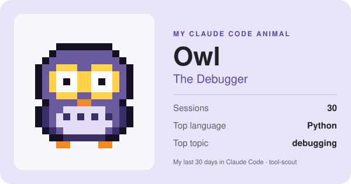
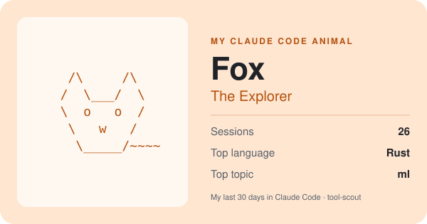
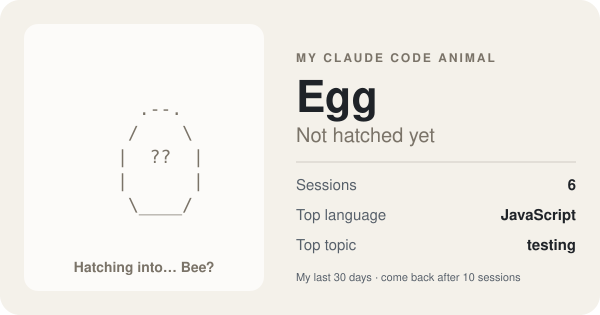
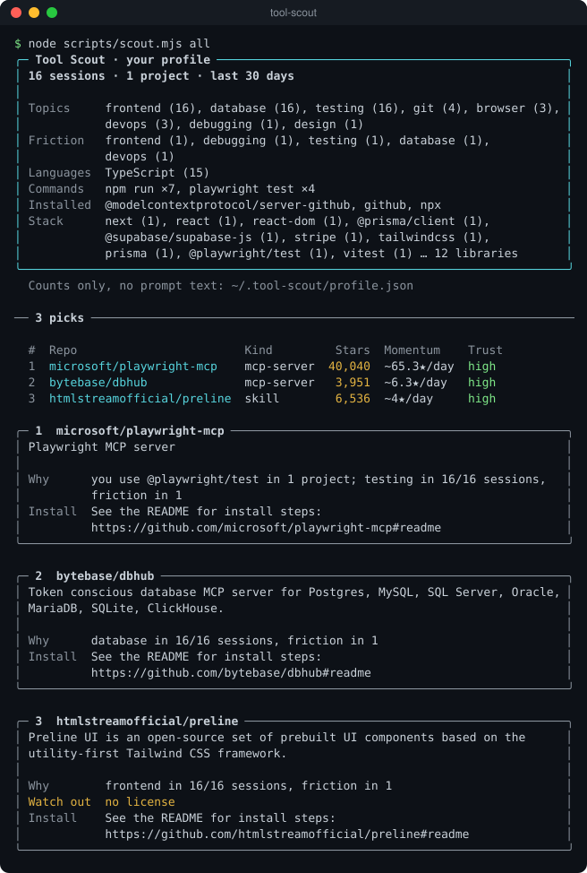

# Tool Scout

[](https://github.com/batrdnn/tool-scout/actions/workflows/test.yml)

Picks trending Claude Code skills, plugins and MCP servers that fit how you actually work, and checks them before you install.

> **Early beta.** Expect rough edges, and please rate the picks: that's how it gets better.

> **Safe mode (v0.17).** An [independent review of v0.16.1](docs/reviews/independent-v0.16.1.pdf) found
> that Tool Scout's installer can't be trusted yet: an agent can confirm its own install plan, an
> existing marketplace name can bring in a different plugin than the one you reviewed, a project-scoped
> write can follow a symlink out of the project, and undo can report success while the change is still
> there. So Tool Scout now **only recommends and checks**. It doesn't install, build or turn on hooks;
> it shows manual steps instead, and anything that writes defaults to project scope, never user. The
> installer is still in the code, behind an experimental setting that is off by default and warns when
> it is on (see [Experimental installer](#experimental-installer-off-by-default)). The fixes are
> planned for v0.18.


## Install

In Claude Code:

```text
/plugin marketplace add batrdnn/tool-scout
/plugin install tool-scout@tool-scout
```

It works in local Claude Code: the terminal or the desktop app. It doesn't work in cloud
sessions, because it reads your local session history. To drive it from a browser, run
`/remote-control` in a local session.

## Requirements

- **Claude Code, running locally** (terminal or desktop app). Cloud sessions (claude.ai/code)
  and claude.ai chat aren't supported. To use it from a browser or phone, run Claude Code
  locally and use `/remote-control`.
- **Some history: about 20+ Claude Code sessions in the last 30 days** is recommended. With
  fewer than 10, you get a "limited history" note and at most 3 picks.
- **macOS, Linux or Windows.** Tested on macOS, Linux and Windows. What differs on Windows, and
  what can't work there (each fails with a message, never silently):
  - Installing an MCP server or an official plugin runs the `claude` CLI, and Tool Scout only runs
    it directly, never through a shell. It needs `claude.exe` (the native installer provides it) on
    your PATH. With only a `claude.cmd` shim (an npm install) it stops and says so; run the printed
    command yourself in that case.
  - File modes (0600/0700) don't exist on Windows. Tool Scout's data folder is under your user
    profile and is protected by that folder's own permissions; if you point `--data` somewhere
    shared, set its permissions yourself.
  - Colors and box drawing need Windows Terminal (or VS Code's terminal). The older console gets
    colors with plain ASCII boxes. `--plain` and `--json` work everywhere.
  - `me --card <file> --open` opens the card with `start`.
- **Node.js 20 or newer.** Check with `node --version`. If it's missing or older, install it
  from [nodejs.org](https://nodejs.org) or with `brew install node`. No other dependencies,
  accounts or API keys are needed.
- **Internet access to `api.github.com`** for the crawl, momentum and trust checks, and to
  `registry.npmjs.org` or `pypi.org` when an install plan pins an MCP server's package (`audit`
  needs none). Behind a proxy, set `NODE_USE_ENV_PROXY=1`.
- **Optional: a GitHub token** (`GITHUB_TOKEN`, or `gh auth login`) makes the catalog refresh
  (1 to 3 minutes, in the background) faster.

## Quick start

1. **Scout:** run `/tool-scout:scout`. The first run starts at once from a small starter catalog
   that ships with Tool Scout, and refreshes it from GitHub in the background (1 to 3 minutes; set
   `GITHUB_TOKEN` or run `gh auth login` to make it faster). `/tool-scout:scout refresh` crawls first.
2. **Rate:** reply like `1 useful, 2 not, 3 useful`.
3. **Repeat weekly:** new tools trend every week, and your ratings show whether it helps.

## Commands

| command | what it does |
|---|---|
| `/tool-scout:scout` | up to 5 picks, each with why it fits you, trust flags and the manual install steps |
| `/tool-scout:scout mcp` · `skills` · `plugins` | only that kind |
| `/tool-scout:scout testing` (any topic) | prefer picks for that topic |
| `/tool-scout:scout refresh` | crawl GitHub again first |
| `/tool-scout:check owner/repo` | trust check of one repo before you install it |
| `/tool-scout:me` | your Claude Code animal (Beaver, Owl, Bee, …) from your last 30 days, plus a shareable card |
| `/tool-scout:kickoff` | give it a project plan: it proposes up to 5 tools for it (install, build or nothing needed) with the manual steps for the ones you choose; it installs nothing |

Or just ask, in plain language:

| say | runs |
|---|---|
| "1 useful, 2 not" | `rate` |
| "not interested in owner/repo" | `dismiss` |
| "bring back owner/repo" | `undismiss` |
| "leave the tool-scout project out" | `exclude-project` |
| "audit what I have installed" | `audit` |
| "show my scout stats" | `stats` |
| "show my share stats" | `stats --share` |
| "show my scout profile" | `profile --show` |
| "what's my Claude Code animal?" | `me` |
| "what does Tool Scout keep about me?" | `privacy` |
| "here's my project plan: what tools should I set up?" | `kickoff --plan-file` |

## Your Claude Code animal

Run `/tool-scout:me` to see which animal your last 30 days look like: Beaver (builder), Owl
(debugger), Bee (tester), Octopus (orchestrator), Ant (grinder), Fox (explorer) or Turtle (deep
diver). Under 10 sessions you're still an Egg. It shows the evidence from your own counts, and
"make me a card" saves a shareable SVG with just the animal, its title, your session count, top
language and top topic. It's for fun: it doesn't change your picks. How it's worked out:
[docs/USAGE.md](docs/USAGE.md#your-claude-code-animal).

<table>
  <tr>
    <td></td>
    <td></td>
    <td></td>
    <td></td>
  </tr>
  <tr>
    <td></td>
    <td></td>
    <td></td>
    <td></td>
  </tr>
</table>

Example cards, made from synthetic profiles (`npm run gallery`).

## Privacy

Tool Scout doesn't upload your history. When you run a skill, a summary goes into Claude's context like anything else you show Claude.

- **What it reads and keeps:** your Claude Code session history, read locally. It saves a profile in
  its data folder: counts of topics and languages, the first word of commands you repeat, and the
  names of the tools, plugins and libraries your projects use. It doesn't save prompt text or file
  contents. A plan you give `/tool-scout:kickoff` is kept in full (`kickoff/needs.json`).
- **What Claude sees:** when you run a skill, the profile summary, the picks, a repo's scan, or your
  kickoff needs list (which quotes lines of your plan) goes into Claude's context, and so to the
  model provider your Claude Code uses. Tool Scout doesn't control that.
- **What goes over the network:** only to `api.github.com`: fixed topic searches, then the names of
  the public repos it is checking, their files and star activity (which can show what you are
  interested in; GitHub sees your token if you set one). With the experimental installer, an install
  plan may also look up a package's current version on npm or PyPI (the package name only). There is
  no Tool Scout server, account or telemetry.
- **Where it is, and how to delete it:** `node scripts/scout.mjs privacy` lists every file Tool Scout
  keeps, what is in it, and the command that deletes it. It all lives in one data folder
  (`~/.claude/plugins/data/tool-scout-…`, or `~/.tool-scout`). Removing the plugin can leave that
  folder behind: delete it with the commands `privacy` prints. `profile --show` shows what the
  profile holds.
- **API keys:** Tool Scout never asks for, reads or stores them; a plan only names the environment
  variables you would set yourself.
- To report a vulnerability, see [SECURITY.md](SECURITY.md).

## Check before you install

Found a skill, plugin or MCP server somewhere else? Run `/tool-scout:check owner/repo` (or
`node scripts/scout.mjs check owner/repo`; a github.com URL works too). It scans the repo's
README, `SKILL.md` files, install scripts, hooks and MCP config, and gives a verdict:

| verdict | meaning |
|---|---|
| `safe-looking` | no medium or high flags, maintained, not archived |
| `review` | medium flags, archived, low metadata trust, or nothing readable: look at the flagged file and line first |
| `do not install` | at least one high flag (prompt injection, hidden instructions, exfiltration, decode-and-run, a download piped into a shell from a script) |

`node scripts/scout.mjs audit` checks what you **already** have (personal skills, installed
plugins, MCP server commands, hooks) from disk, with no network at all.

Both are heuristics: no flags doesn't mean safe. Skills and MCP servers run with your
permissions. The check shows what it looked at (the README and up to eight files, not an MCP
server's full source), and for a pick it gives **manual steps**: read the repo, then follow its
README yourself, in your own terminal, at project scope. Tool Scout doesn't install it for you.

## Project kickoff

Starting something new? Run `/tool-scout:kickoff` and paste your plan, or give the path of a plan
file (and the project folder, if there is one). Claude turns it into a needs list: tasks, stack,
domain and conventions.

- **Where your plan goes:** Tool Scout doesn't upload it. It is kept in full in the data folder
  (`kickoff/needs.json`), and, as with any skill, the needs list (which quotes lines of your plan)
  goes into Claude's context when you run kickoff. Matching uses the local catalog and the
  project's dependency files.
- **Toolkit, at most 5 items, by impact,** each with one reason tied to your plan. Candidates are
  Anthropic's official marketplace and built-in Claude Code features (like `/ultrareview`) first,
  then the best catalog match (the same ranking, effort estimate and trust checks as the scout), or
  a proposal to build your own, or "nothing needed: Claude handles this without a tool".
- **Claude judges every match** with the scout's own filtering before showing it, and never shows
  one it calls weak: that need becomes "nothing needed" or a build proposal.
- **Not a tool need:** CI config files, icons and posts are "nothing needed: Claude does this
  directly", with one line on how.
- **Heavy setup:** a match that needs a local service, or more than 3 credentials your plan
  doesn't mention, is ranked lower and labeled "heavy setup".
- **CLAUDE.md note:** only the conventions not already in your CLAUDE.md; none is offered when all
  are covered. An item Claude has doubts about gets "Skip (recommended)" first in its yes/no.
- **You choose** the items in one multi-select question. Then each one gets its **manual steps**
  (check it, read it, install it yourself at project scope), or, for something to build, a draft
  in chat for you to read and save yourself. Kickoff installs and builds nothing.
- **Summary:** which items got manual steps, and which you skipped.

## Experimental installer (off by default)

Everything Tool Scout used to do to install or build things for you (`install`, `build`, hook
activation) is switched off in v0.17. The code is still there, behind a setting you turn on yourself,
**in your own terminal** (in Claude Code, start the line with `!`):

```bash
node scripts/scout.mjs experimental on     # off again: experimental off; status: experimental
```

Don't ask Claude to run that for you: the point is that you decide. Every run of `install` or `build`
then prints a warning, because the independent review reproduced these failures, which are **known and
planned for v0.18**:

- **Confirmation isn't a human decision (C1).** A plan's confirmation checks that the plan wasn't
  changed, not that a person agreed: an agent that makes a plan can confirm its own plan.
- **A marketplace name can bring in a different plugin (C2).** If a marketplace with the same name is
  already registered from another source, the plugin installs from that one, and the pinned-commit
  check doesn't run.
- **A symlink can redirect a project-scoped write (C5).** A `.claude` folder that is a symlink sends a
  build outside the project.
- **Undo can report success while the change is still there (C6).** If the inverse command fails, undo
  still says it worked.

If you do use it: the default scope is project (`--scope user` only when you ask for it), read every
plan yourself, and check the result by hand afterwards. `undo` and `installed` always work, so what an
older version installed can still be removed (and checked: look that the thing is really gone).

How it works when it is on:

- **Plan** (`install owner/repo --plan`) writes nothing. It shows the files and settings, the commit it
  pins, the check verdict and the credentials you set yourself.
- **Install** (`--confirm <planId>`, within 15 minutes) runs that plan and stops if the verdict is "do
  not install" or the repo changed. It never runs install scripts or README commands.
- **Undo** (`undo <name>`) tries to remove what was logged and restore your settings. See C6 above.

### Build your own (experimental)

With the installer on, you can ask "build me a skill that …" for a skill, slash command, subagent, hook
or CLAUDE.md memory (a section between markers). With it off, Claude can still show you a draft in chat
for you to read and save yourself.

- Claude asks at most two short questions (what exactly, and for all your projects or just this one),
  reads a pick's SKILL.md for ideas only, and writes a draft in its own words, tailored to your topics
  and stack. The draft goes into Tool Scout's data folder, not straight into `~/.claude` or your project.
- **Plan** (`build --form skill --name <name> --from <draft> --plan`) writes nothing. It shows each file
  and where it goes, the trust scan of the draft (nothing above low, no network call or pipe-to-shell),
  and the source repo's license: with no license nothing may be copied; a permissive one allows adapting
  with an attribution line.
- **Build** (`build --confirm <planId>`) writes that plan. A hook (a script that runs automatically on
  Claude Code events, in this project by default) is shown in full, may not use the network, and needs a
  second, separate confirmation (`--confirm-hook`); this is hook activation, off unless the installer is on.
- **Undo** (`undo <name>`) tries to remove what was built; for memory, just that section.
- **Replace** (`--replace` on the plan): to update a skill, command, subagent or memory section you
  already have, the new version is swapped in one step, and undo puts the previous version back. An
  installed skill folder works the same way (`install … --replace --plan`).
- A hook can also be **personal**: it runs in this project for you alone. Its entry goes into the
  project's `.claude/settings.local.json` (not shared) and its script stays outside the project.

## Command line

```bash
node scripts/scout.mjs all                # profile + crawl (if stale) + picks
node scripts/scout.mjs profile --show     # what it learned about you, and the data folder in use
node scripts/scout.mjs check owner/repo   # trust check of one repo
node scripts/scout.mjs audit              # local scan of what you have installed
node scripts/scout.mjs rate owner/repo useful|not|clear
node scripts/scout.mjs dismiss owner/repo # also: undismiss, exclude-project, include-project
node scripts/scout.mjs stats [--share]
node scripts/scout.mjs me --card me.svg   # your Claude Code animal, plus a shareable SVG card
node scripts/scout.mjs privacy            # every file Tool Scout keeps, what is in it, how to delete it
node scripts/scout.mjs kickoff --plan-file PLAN.md --project .   # needs list + toolkit for a plan; installs nothing
node scripts/scout.mjs installed          # what an older version or the experimental installer installed; undo <name> removes one
```

The experimental installer's commands (`install … --plan`, `install … --confirm`, `build …`) only run
after `experimental on`; see [above](#experimental-installer-off-by-default).

Data folder: `--data DIR`, else `$SCOUT_DATA`, else the installed plugin's folder, else
`~/.tool-scout`. All options, how ranking and trust scoring work, and the eval setup:
[docs/USAGE.md](docs/USAGE.md).

## In a terminal

Run directly in a terminal, the output has colors, boxes and aligned columns:



- It's only like this when the output goes straight to a terminal. Through a pipe or a file, and
  always inside Claude Code, you get the plain text, unchanged from earlier versions.
- `--plain` gives the plain text in a terminal too. `--json` is unchanged.
- `NO_COLOR=1` turns colors off and keeps the layout. Without a UTF-8 locale (for example
  `LANG=C`) the boxes are drawn in ASCII.
- Inside Claude Code the skills always run the script with `--json` or `--plain`, so Claude never
  sees escape codes. After the picks, Claude asks what to do next with each one: how to install it
  (manual steps), check it first, rate it, or mark it not interested.

## FAQ

### What does it send, and what stays on my machine?
Tool Scout doesn't upload your history. When you run a skill, a summary goes into Claude's context like anything else you show Claude.
Your session history is read locally and saved as a profile: counts of topics and languages, the first
word of commands you repeat, and the names of the tools and libraries your projects use (no prompt
text or file contents). The only requests go to `api.github.com` (fixed topic searches, then the names
of public repos it checks), and, with the experimental installer, to npm or PyPI for a package's current
version. There's no account, and it never reads or stores your API keys. `node scripts/scout.mjs
privacy` lists every file it keeps and how to delete it; `profile --show` prints what the profile
holds and where it's stored.

### Does it install anything?
No. Since v0.17 Tool Scout only recommends and checks: it shows manual steps (read the repo, then
install it yourself, in your own terminal, at project scope), and it doesn't install, build or turn on
hooks. An independent review found problems in the installer (a plan can be confirmed by the same
agent that made it, undo can report success when it hasn't worked), so it's off by default, and
experimental when you turn it on yourself. Its plans, confirmations and undo are described under
[Experimental installer](#experimental-installer-off-by-default), with the known issues.

### Does it work offline?
Yes, with `--offline`, which makes **no network request at all** (this is checked by a test). `audit`,
`me`, `profile`, `stats`, `rate`, `privacy` and `kickoff` read only local files. `recommend --offline`
and `all --offline` rank from the saved catalog and say how old it is (`all` normally crawls GitHub
again when the catalog is over 20 hours old; offline it doesn't). With no saved catalog yet, they stop
with a message: run once without `--offline`. `check`, `crawl` and `line` need GitHub and say so.

### Does it work on Windows?
Yes: macOS, Linux and Windows are tested in CI. The read-only commands (scout, check, audit, me,
kickoff) work on all three, and the pretty terminal output needs Windows Terminal. The experimental
installer, if you turn it on, needs `claude.exe` on your PATH. Details are in
[Requirements](#requirements).

### What is the animal?
A bit of fun: `/tool-scout:me` looks at the saved profile from your last 30 days and names how you work:
Beaver (builder), Owl (debugger), Bee (tester), Octopus (orchestrator), Ant (grinder), Fox
(explorer) or Turtle (deep diver). Under 10 sessions you're an Egg. It doesn't change your picks.
See [Your Claude Code animal](#your-claude-code-animal).

### How do I uninstall everything?
In this order, because the list of what Tool Scout installed lives in its data folder:

1. If an older version, or the experimental installer, installed or built things for you:
   `node scripts/scout.mjs installed` lists them, and `node scripts/scout.mjs undo <name>` removes
   each one you don't want to keep. Then check the result yourself (undo can say it worked when it
   didn't: for an MCP server, look at `claude mcp list`). On v0.17 with the installer never turned
   on, there is nothing to undo.
2. `/plugin uninstall tool-scout@tool-scout` removes the plugin. It can leave the data folder behind.
3. Delete the data folder (`node scripts/scout.mjs privacy` prints its path and the command), which is
   `~/.tool-scout` if you ran it from a copy of the repo (or the folder you gave to `--data`).

### How do I report a security issue?
Privately, with GitHub's private vulnerability reporting, not a public issue. The link and what to
include are in [SECURITY.md](SECURITY.md).

## Updating

To update to the newest version:

1. **Update now:** in `/plugin`, open the **Installed** tab, pick Tool Scout and choose
   **Update now**. Or, from a shell: `claude plugin update tool-scout@tool-scout`.
2. **Reload:** run `/reload-plugins` (or restart Claude Code) so the new version is loaded.

We recommend turning on **auto-update** for the `tool-scout` marketplace in the **Marketplaces**
tab of `/plugin`, so new releases arrive on their own.

Note: `/plugin marketplace update` alone only refreshes the marketplace listing. It doesn't update
the installed plugin. What changed in each release: [CHANGELOG.md](CHANGELOG.md).

## Development

```bash
npm test                # node --test, no dependencies: only failures and a one-line summary
npm run test:verbose    # every test, with the full output
```

Testers: see [TESTING.md](TESTING.md). Eval setup: [docs/USAGE.md](docs/USAGE.md#eval-setup).

## Roadmap

- Deeper trust checks: follow scripts that installers download; scan MCP server source, not just configs
- v0.18: an approval step outside the agent, verified marketplace sources, project-confined writes and undo that checks its result; then the installer can come back
- Weekly digest via a Claude Code hook ("3 new tools match your work")
- Learn from feedback: down-weight topics whose picks keep getting dismissed
- v1.1: animal evolution (Egg → hatchling → adult → legendary) and a status line companion
