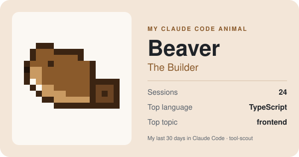
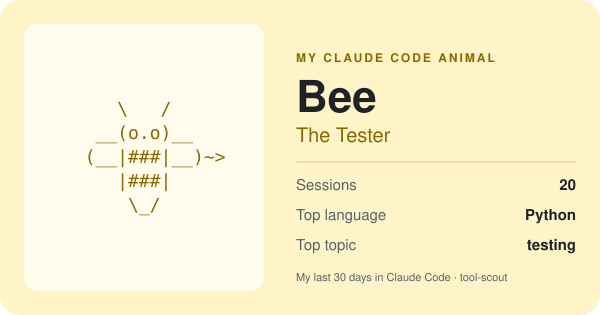
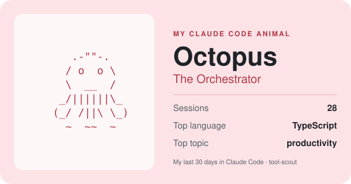
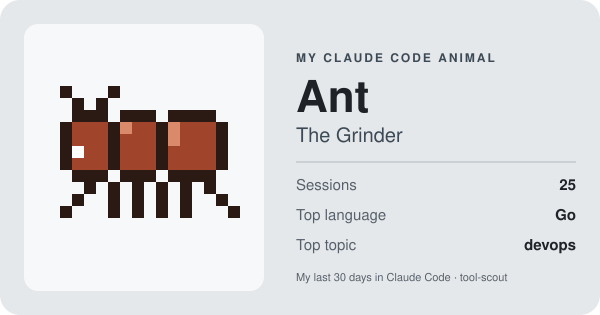
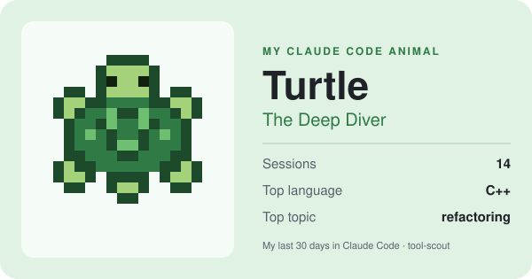

# Tool Scout

Picks trending Claude Code skills, plugins and MCP servers that fit how you actually work, and checks them before you install.

> **Early beta.** Expect rough edges, and please rate the picks: that's how it gets better.

## Install

In Claude Code:

```text
/plugin marketplace add batrdnn/tool-scout
/plugin install tool-scout@tool-scout
```

It works in local Claude Code: the terminal or the desktop app. It doesn't work in cloud
sessions, because it reads your local session history. To drive it from a browser, run
`/remote-control` in a local session.

## Requirements

- **Claude Code, running locally** (terminal or desktop app). Cloud sessions (claude.ai/code)
  and claude.ai chat aren't supported. To use it from a browser or phone, run Claude Code
  locally and use `/remote-control`.
- **Some history: about 20+ Claude Code sessions in the last 30 days** is recommended. With
  fewer than 10, you get a "limited history" note and at most 3 picks.
- **macOS or Linux.** Tested on both. Windows is untested (WSL should work).
- **Node.js 18 or newer.** Check with `node --version`. If it's missing or older, install it
  from [nodejs.org](https://nodejs.org) or with `brew install node`. No other dependencies,
  accounts or API keys are needed.
- **Internet access to `api.github.com`** for the crawl, momentum and trust checks (`audit`
  needs none). Behind a proxy, set `NODE_USE_ENV_PROXY=1`.
- **Optional: a GitHub token** (`GITHUB_TOKEN`, or `gh auth login`) makes the first crawl faster
  than the usual 1 to 3 minutes.

## Quick start

1. **Scout:** run `/tool-scout:scout`. The first run crawls GitHub (1 to 3 minutes; set
   `GITHUB_TOKEN` or run `gh auth login` to make it faster).
2. **Rate:** reply like `1 useful, 2 not, 3 useful`.
3. **Repeat weekly:** new tools trend every week, and your ratings show whether it helps.

## Commands

| command | what it does |
|---|---|
| `/tool-scout:scout` | up to 5 picks, each with why it fits you, trust flags and the install command |
| `/tool-scout:scout mcp` · `skills` · `plugins` | only that kind |
| `/tool-scout:scout testing` (any topic) | prefer picks for that topic |
| `/tool-scout:scout refresh` | crawl GitHub again first |
| `/tool-scout:check owner/repo` | trust check of one repo before you install it |
| `/tool-scout:me` | your Claude Code animal (Beaver, Owl, Bee, …) from your last 30 days, plus a shareable card |

Or just ask, in plain language:

| say | runs |
|---|---|
| "1 useful, 2 not" | `rate` |
| "not interested in owner/repo" | `dismiss` |
| "bring back owner/repo" | `undismiss` |
| "leave the tool-scout project out" | `exclude-project` |
| "audit what I have installed" | `audit` |
| "show my scout stats" | `stats` |
| "show my share stats" | `stats --share` |
| "show my scout profile" | `profile --show` |
| "what's my Claude Code animal?" | `me` |

## Your Claude Code animal

Run `/tool-scout:me` to see which animal your last 30 days look like: Beaver (builder), Owl
(debugger), Bee (tester), Octopus (orchestrator), Ant (grinder), Fox (explorer) or Turtle (deep
diver). Under 10 sessions you're still an Egg. It shows the evidence from your own counts, and
"make me a card" saves a shareable SVG with just the animal, its title, your session count, top
language and top topic. It's for fun: it doesn't change your picks. How it's worked out:
[docs/USAGE.md](docs/USAGE.md#your-claude-code-animal).

<table>
  <tr>
    <td></td>
    <td></td>
    <td></td>
    <td></td>
  </tr>
  <tr>
    <td></td>
    <td></td>
    <td></td>
    <td></td>
  </tr>
</table>

Example cards, made from synthetic profiles (`npm run gallery`).

## Privacy

- Your session history is read **locally** and kept as **counts only**: no prompt text, file
  paths or command arguments.
- GitHub gets fixed topic searches and public repo names. Nothing about you is sent.
- Data lives in the plugin's data folder (`~/.claude/plugins/data/tool-scout-…`) and is deleted
  when you uninstall. `profile --show` shows exactly what it learned and where it's stored.
- Tool Scout installs only after you approve a plan, and every install can be undone. It never
  asks for, reads or stores your API keys: a plan names the environment variables you set yourself.

## Check before you install

Found a skill, plugin or MCP server somewhere else? Run `/tool-scout:check owner/repo` (or
`node scripts/scout.mjs check owner/repo`; a github.com URL works too). It scans the repo's
README, `SKILL.md` files, install scripts, hooks and MCP config, and gives a verdict:

| verdict | meaning |
|---|---|
| `safe-looking` | no medium or high flags, maintained, not archived |
| `review` | medium flags, archived, low metadata trust, or nothing readable: look at the flagged file and line first |
| `do not install` | at least one high flag (prompt injection, hidden instructions, exfiltration, decode-and-run, a download piped into a shell from a script) |

`node scripts/scout.mjs audit` checks what you **already** have (personal skills, installed
plugins, MCP server commands, hooks) from disk, with no network at all.

Both are heuristics: no flags doesn't mean safe. Skills and MCP servers run with your
permissions. Tool Scout installs only after you approve a plan, and every install can be undone:

- **Plan** (`install owner/repo --plan`) writes nothing. It shows the exact files and settings,
  the commit it pins, the check verdict and the credentials you set yourself.
- **Install** (`--confirm <planId>`, within 15 minutes) does exactly that plan, and refuses if the
  verdict is "do not install" or anything changed. It never runs install scripts or README
  commands.
- **Undo** (`undo <name>`) removes exactly what was logged and restores your settings.

## Command line

```bash
node scripts/scout.mjs all                # profile + crawl (if stale) + picks
node scripts/scout.mjs profile --show     # what it learned about you, and the data folder in use
node scripts/scout.mjs check owner/repo   # trust check of one repo
node scripts/scout.mjs audit              # local scan of what you have installed
node scripts/scout.mjs rate owner/repo useful|not|clear
node scripts/scout.mjs dismiss owner/repo # also: undismiss, exclude-project, include-project
node scripts/scout.mjs stats [--share]
node scripts/scout.mjs me --card me.svg   # your Claude Code animal, plus a shareable SVG card
node scripts/scout.mjs install owner/repo --plan            # what an install would do; writes nothing
node scripts/scout.mjs install owner/repo --confirm <planId> # do exactly that plan
node scripts/scout.mjs installed          # what Tool Scout installed; scout.mjs undo <name> removes one
```

Data folder: `--data DIR`, else `$SCOUT_DATA`, else the installed plugin's folder, else
`~/.tool-scout`. All options, how ranking and trust scoring work, and the eval setup:
[docs/USAGE.md](docs/USAGE.md).

## In a terminal

Run directly in a terminal, the output has colors, boxes and aligned columns:


- It's only like this when the output goes straight to a terminal. Through a pipe or a file, and
  always inside Claude Code, you get the plain text, unchanged from earlier versions.
- `--plain` gives the plain text in a terminal too. `--json` is unchanged.
- `NO_COLOR=1` turns colors off and keeps the layout. Without a UTF-8 locale (for example
  `LANG=C`) the boxes are drawn in ASCII.
- Inside Claude Code the skills always run the script with `--json` or `--plain`, so Claude never
  sees escape codes. After the picks, Claude asks what to do next with each one: why build vs
  install, install it (a plan first, then one yes/no question for that one tool), rate it, or mark
  it not interested.

## Updating

To update to the newest version:

1. **Update now:** in `/plugin`, open the **Installed** tab, pick Tool Scout and choose
   **Update now**. Or, from a shell: `claude plugin update tool-scout@tool-scout`.
2. **Reload:** run `/reload-plugins` (or restart Claude Code) so the new version is loaded.

We recommend turning on **auto-update** for the `tool-scout` marketplace in the **Marketplaces**
tab of `/plugin`, so new releases arrive on their own.

Note: `/plugin marketplace update` alone only refreshes the marketplace listing. It doesn't update
the installed plugin. What changed in each release: [CHANGELOG.md](CHANGELOG.md).

## Development

```bash
npm test     # node --test, no dependencies
```

Testers: see [TESTING.md](TESTING.md). Eval setup: [docs/USAGE.md](docs/USAGE.md#eval-setup).

## Roadmap

- Deeper trust checks: follow scripts that installers download; scan MCP server source, not just configs
- One-click install with a confirmation prompt
- Weekly digest via a Claude Code hook ("3 new tools match your work")
- Learn from feedback: down-weight topics whose picks keep getting dismissed
